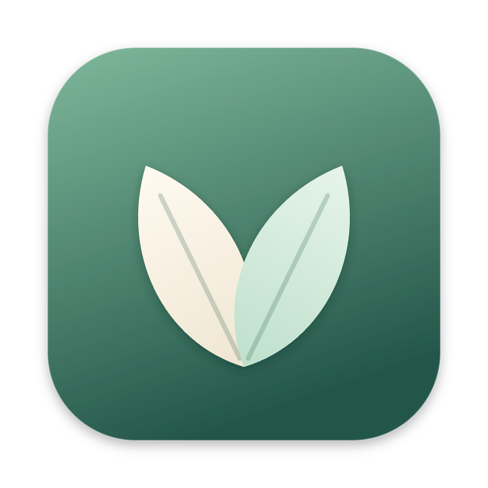
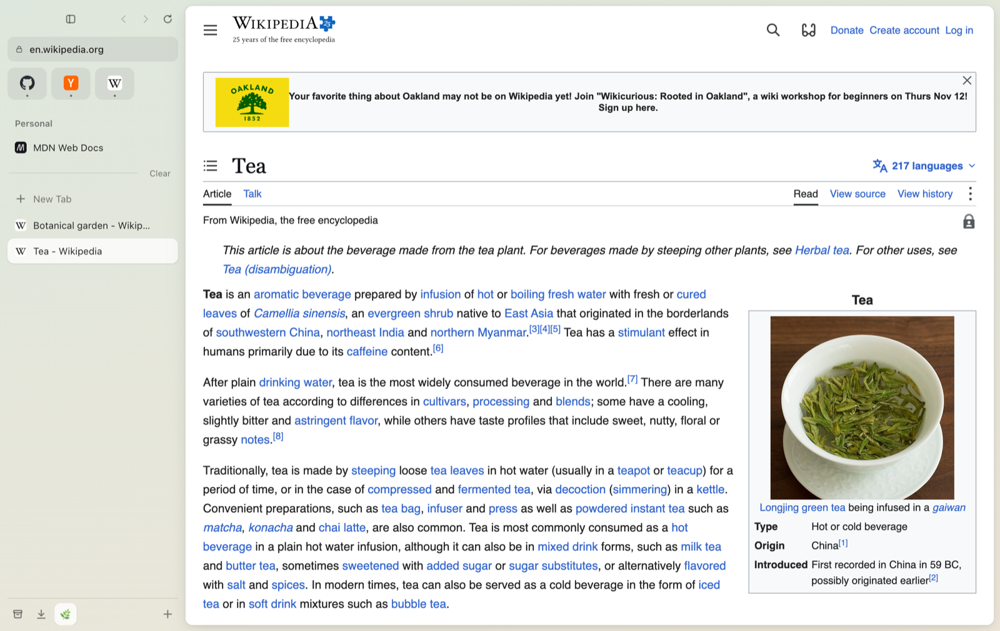
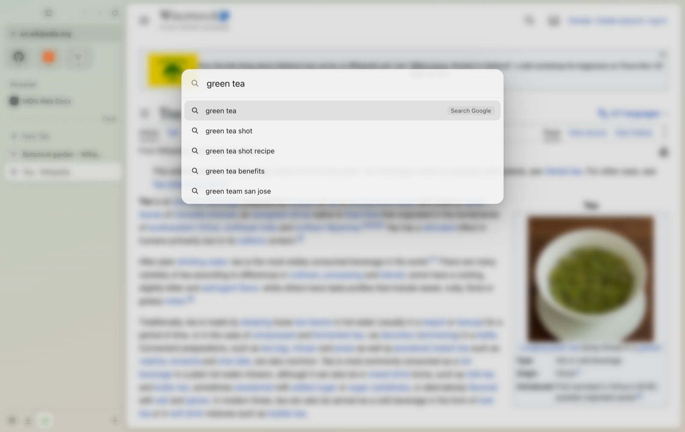
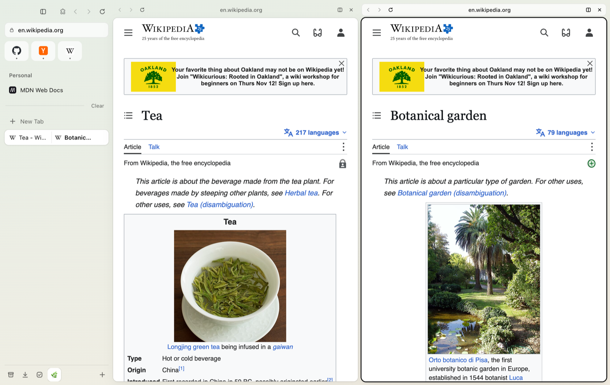
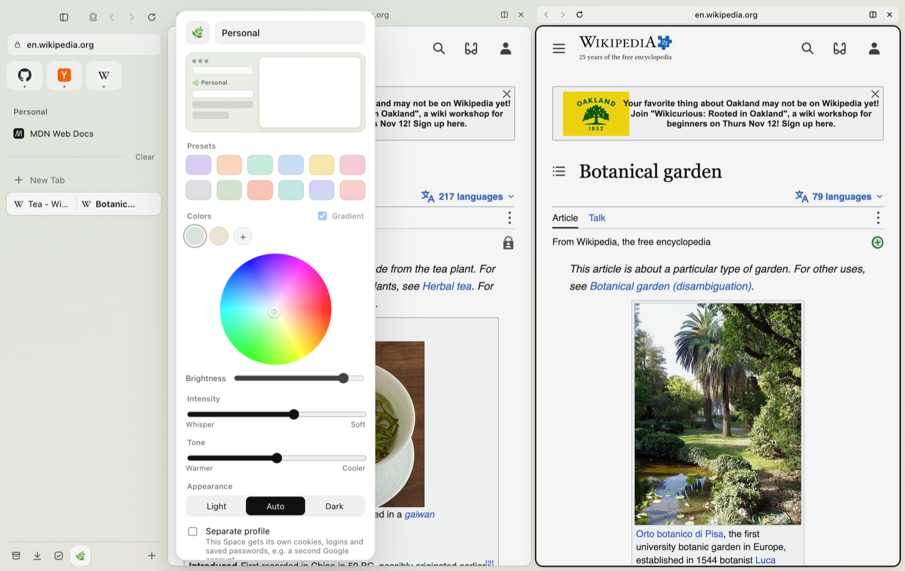

<p align="center"></p>

# VAIA

**A calm, sidebar-first browser for Mac.**

VAIA is a desktop web browser built around a vertical sidebar, a floating command bar, Spaces, and an uncluttered, card-like content area. It's an independent, original project built with Electron, React, and TypeScript.



## Download

Get the latest version from the [Releases page](https://github.com/vxplim/vaia/releases/latest):

| Your Mac | Download |
|---|---|
| Apple Silicon (M1, M2, M3, M4…) | `VAIA-1.0.0-arm64.dmg` |
| Intel | `VAIA-1.0.0-x64.dmg` |

Not sure which? Apple menu  → **About This Mac**. If "Chip" says Apple M-something, pick Apple Silicon.

## Install

1. Open the `.dmg` you downloaded and drag **VAIA** into the **Applications** folder.
2. Open VAIA from Applications. The first time, macOS says it can't verify the app (VAIA isn't signed with a paid Apple Developer ID yet). Click **Done** (not "Move to Trash").
3. Open **System Settings → Privacy & Security**, scroll down to "VAIA was blocked…" and click **Open Anyway**, then enter your Mac password and click **Open Anyway** again.
4. That's it. macOS remembers your choice, so from now on VAIA opens normally.

Optional: make VAIA your default browser from the VAIA menu → **Make VAIA Your Default Browser**.

## Features

- ✅ Vertical sidebar tabs with favicons, and web pages that float in a rounded card
- ✅ Compact address pill: type a URL or search
- ✅ Tabs restored when you reopen the app
- ✅ Command Bar (⌘T): open sites, search with suggestions, switch tabs, search history, run commands
- ✅ Favorites (icon tiles), Pinned tabs with folders, and Today tabs, all with drag and drop
- ✅ Pinned tabs remember their home page, and closing them puts them to sleep instead of losing them
- ✅ Spaces with their own emoji, color/gradient theme, light/dark mode, and optional separate profile (separate logins); switch with ⌃1…⌃9 or a swipe
- ✅ Auto-archive of Today tabs you haven't viewed in a while (12h / 24h / 7d / 30d / never), a searchable Archive, and ⇧⌘T to reopen closed tabs
- ✅ Split View: 2–4 tabs side by side with resizable dividers (drag a tab onto the page, right-click, or ⌃⇧=)
- ✅ Peek: links from pinned tabs open in a floating preview card you can expand into a tab
- ✅ Little window (⌥⌘N) for quick lookups, and links from other apps when VAIA is your default browser
- ✅ Hideable sidebar (⌘S) that slides out when you hover the left edge
- ✅ Settings window, Downloads popover, History page, Find in page (⌘F)
- ✅ Built-in ad and tracker blocker (open-source EasyList filters)
- ✅ Boosts: recolor any website, change its font, zap away elements, and add your own CSS/JS
- ✅ Tidy: group Today tabs by website and close duplicates in one click (with Undo), or let Claude sort them into topic folders with your own API key
- ✅ To-do list per Space (or everywhere): slide-out panel (⇧⌘K), sidebar section, and a pop-out window that can stay on top; due dates, linked pages, and "todo …" in the Command Bar
- ✅ Keyboard-friendly: ⌘T, ⌘W, ⌘L, ⌘R, ⌘[ / ⌘], ⇧⌘T, ⇧⌘C, ⌘S, ⌘F, ⌃1…⌃9, ⌃⇧=, ⌥⌘N, ⌘Y, ⌘, (full list in Settings)

## Screenshots

| | |
|---|---|
|  **Command Bar** (⌘T) |  **Split View** |
|  **Spaces with their own themes** | |

## Run it from the code

You need [Node.js](https://nodejs.org) (version 22 or newer).

```bash
git clone https://github.com/vxplim/vaia.git
cd vaia
npm install
npm run dev
```

| Command | What it does |
|---|---|
| `npm run dev` | Runs VAIA in development mode with live reload |
| `npm run build` | Checks the code for errors and builds it |
| `npm run build:mac` | Packages VAIA into Mac `.dmg` installers for Apple Silicon and Intel (in `dist/`) |

## License

[MIT](LICENSE) © Vanessa Minerva Lim
